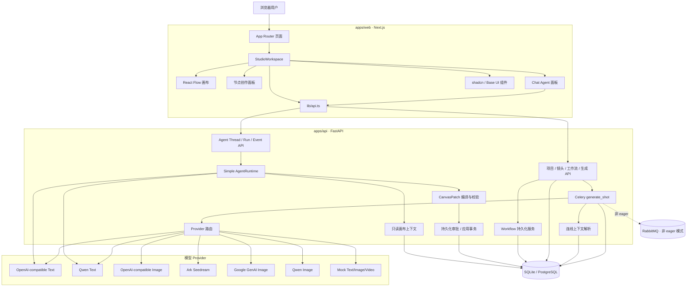
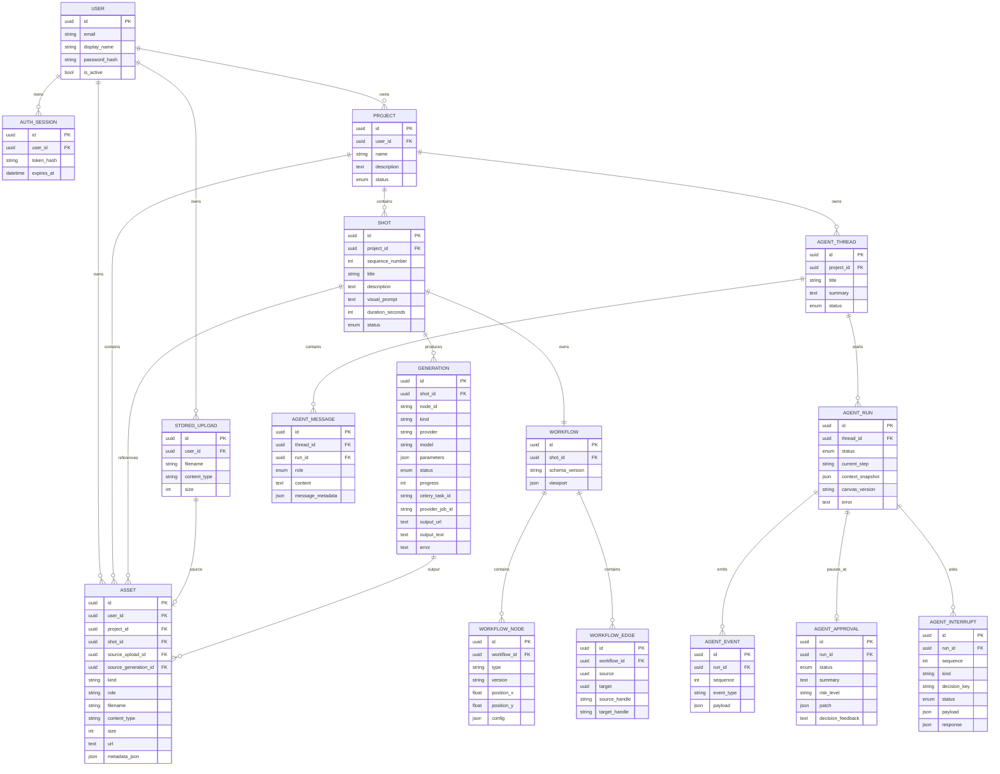
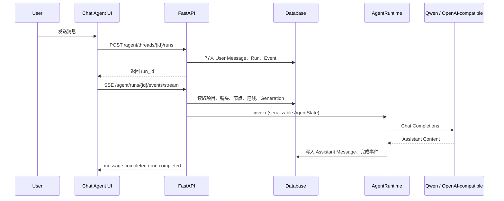
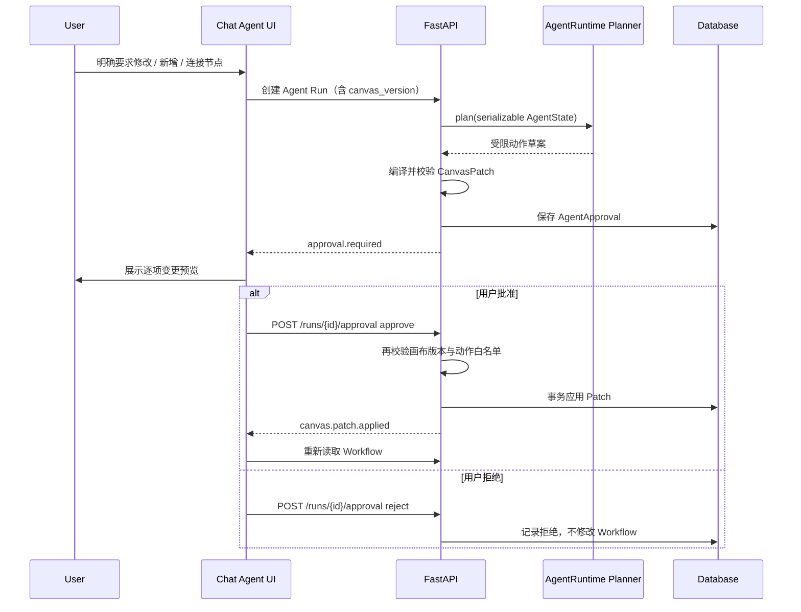
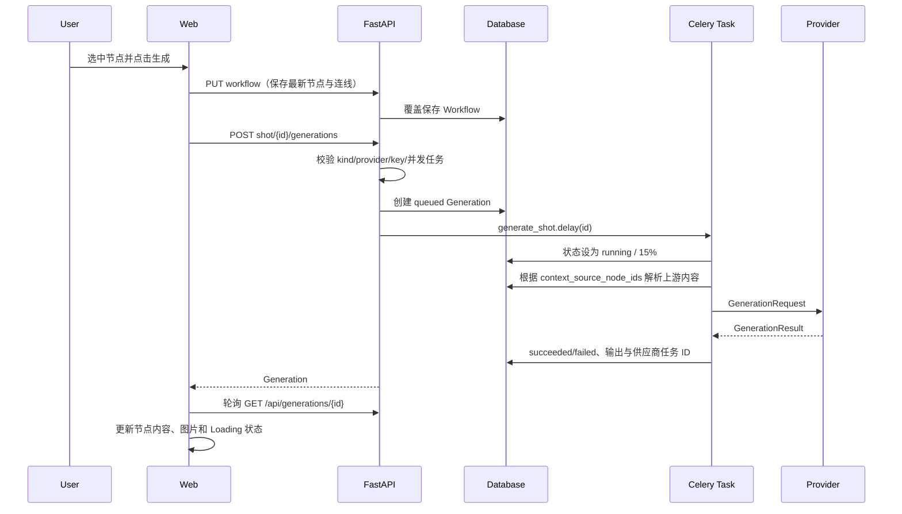
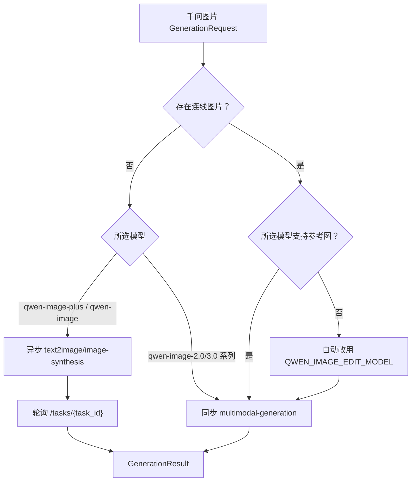
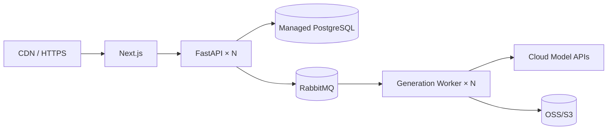

# AI Video Studio Web AI 创作平台架构设计

版本：1.0  
日期：2026-08-17  
状态：当前实现基线（As-Is）与下一阶段演进设计  
代码范围：`apps/web`、`apps/api`、`packages/workflow-schema`

## 1. 文档目的

本文以仓库当前可运行代码为事实来源，描述已经实现的系统边界、数据流、模型 Provider、工作流持久化和任务执行方式，并单独标记尚未实现的目标能力。

当前产品是一个浏览器端 AI 创作画布：用户按镜头组织文本、提示词、生成节点与依赖连线，调用云端文本、图片模型或本地 H3 视频模型，并在画布中查看生成结果。

当前系统已具备单节点文生视频闭环，但仍不是完整的视频生产平台；专业时间轴、音频生成、对象存储、Workflow Compiler、权限和计费尚未实现。Chat Agent 已通过 SSE 提供运行事件和模型内容增量流。

## 2. 当前能力边界

### 2.1 已实现

- 项目和镜头的读取、创建与编辑。
- 本地默认免登录并使用稳定的单用户身份；部署开启 `AUTH_REQUIRED=true` 后，支持邮箱密码注册、登录、退出和持久会话。密码使用带随机盐的 scrypt 保存，会话 Token 仅以 SHA-256 摘要落库并通过 HttpOnly Cookie 传递。
- 项目所有权隔离覆盖镜头、工作流、Generation、Agent Thread/Run/Event 和上传素材；越权访问统一返回 404。
- 每个镜头一份独立 Product Workflow。
- 工作流节点、连线、位置和视口持久化。
- 新增统一空白节点，选中后配置为文本、图片或视频模式；音频模式仅保留已保存草稿的协议兼容性，当前不开放入口。
- 节点 Prompt、模型、Provider、画幅、分辨率、质量、数量和高级参数配置。
- 文本节点内容手动编辑。
- React Flow 节点拖拽、连接、删除、缩放、MiniMap 和自定义动画连线。
- 节点选中时显示底部创作面板，生成期间锁定节点并展示 Loading。
- 生成记录持久化及前端状态轮询。
- 提供镜头级运行接口，按工作流拓扑顺序执行已配置的生成节点；当前本地实现依赖 eager 任务模式，异步 Worker 链式调度仍待补齐。
- 连线节点内容作为下游生成上下文。
- OpenAI-compatible、千问文本模型调用。
- OpenAI-compatible、Seedream、Gemini、千问图片模型调用。
- 千问纯文生图和带参考图的图片编辑/融合自动分流。
- 本地 MiniMax H3 异步视频 Provider、Generation 状态轮询和节点内视频播放。
- 节点参考图片上传、本地文件持久化、缩略图预览和移除；上传图片可进入千问图片编辑及本地 H3 首尾帧上下文。
- Mock 文本、图片和视频 Provider，用于无凭证编排测试。
- 右侧 Chat Agent，以及项目、镜头、节点、连线和最近生成任务上下文。
- Agent Thread、Run、Message、Event 持久化，以及 SSE 内容增量、停止回答和部分内容恢复。
- 受控 CanvasPatch 计划、持久化审批、批准/拒绝和应用后画布刷新。
- 通用 `AgentInterrupt` 1:N 中断协议；支持单选卡片、刷新恢复、同一 Run Resume，并可串联后续 CanvasPatch 审批。
- CanvasPatch 当前允许修改节点配置、新增生成节点、连接节点和绑定项目图片资产，不允许删除或启动生成。
- Chat Agent 具备首个受控生成工具闭环：读取当前选中节点配置、记录 Tool Event、展示可能计费的生成确认、确认后创建 Generation，并由画布接管进度轮询与结果展示。
- 项目资产库 P0 已实现：上传图片、项目级资产查询、搜索/类型筛选、下载、删除引用保护，以及生成图片/视频/视频末帧自动入库。
- Agent 资产绑定 P0.5 已实现：Agent 上下文读取资产目录，审批式 `bind_asset` 操作可将图片绑定为普通参考图、视频首帧或尾帧；服务端校验项目归属、资产类型、节点模式和最多 8 张素材限制。
- `@` 引用 P0 已实现：Chat Agent 和节点提示词输入提供统一引用选择器，引用画布节点、项目资产、镜头和最近生成结果；前端保留可读别名，运行上下文携带结构化 `type/id/label`，服务端解析并校验归属后注入模型上下文。
- Chat Agent Skill P0 已实现：服务端维护来源可追溯的内置 Skill Catalog，当前包含视频导演、稳定提示词、分镜连续性、H3 全参考、本地视频生产和剧本转漫画；前端提供搜索、收藏、我的、自定义创建和选择启用；Skill 规则作为 Agent Run 的可序列化上下文注入，不绕过现有 CanvasPatch 审批与生成确认。
- 可替换 `AgentRuntime` 边界；当前使用轻量 Runtime，状态与审批协议面向未来 LangGraph。

### 2.2 尚未实现

- 云端视频 Provider、图生视频与音频 Provider。
- 对象存储、资产版本和生成结果永久归档；当前已实现项目级资产目录和本地/临时 URL 注册。
- OSS/S3 对象存储及临时 URL 导入。
- Workflow Compiler、DAG 拓扑调度和整图运行。
- 正式 Workflow Version、Execution Snapshot、WorkflowRun 和 NodeRun（Agent Patch 当前仅用 `updated_at` 做乐观冲突检查）。
- 任务幂等键、断点恢复和供应商 Webhook；Generation 已支持失败重试、协作式取消和前端状态轮询。
- Generation 实时事件和 WebSocket。
- 组织、项目成员权限、邮箱验证、密码找回、额度、计费和审计。
- FFmpeg 合成、字幕、音轨和正式时间轴。
- ComfyUI Adapter。

## 3. 核心架构决策

### ADR-001：Product Workflow 是业务工作流

React Flow 画布保存的是产品级节点，不向用户暴露 `LoadCheckpoint`、`KSampler` 等底层推理节点。工作流使用自有 `schema_version + nodes + edges + viewport` 格式，并由 FastAPI 持久化。

### ADR-002：ComfyUI 不进入当前核心链路

当前文本与图片能力主要调用云 API，不需要部署本地模型或 GPU。ComfyUI 只保留为未来可选 Provider，不作为 Product Workflow 的存储格式，也不承担当前任务状态管理。

### ADR-003：节点保存 Provider 与 Model

前端模型下拉项来自 `/api/providers`。生成节点的 `config` 同时保存 `provider` 和 `model`，执行时后端再次校验 Provider 与密钥配置，避免模型名与实际调用通道错配。

### ADR-004：连线是生成上下文，不是完整 DAG 调度

当前连线用于声明一个节点生成时要引用哪些上游节点。前端把直接上游节点 ID 写入 `context_source_node_ids`，后端解析这些节点最近成功的文本或图片结果。节点上传的参考图元数据写入 `uploaded_assets`，Worker 从受控上传目录读取文件并转换为 Base64 图片上下文，不依赖公网 URL。

当前不会自动按拓扑执行整张图，也不进行环检测和端口类型检查。

### ADR-005：开发环境优先同步闭环

Celery 默认设置 `task_always_eager=true`，API 创建 Generation 后可在同一进程内立即执行，便于本地开发。关闭 eager 后使用 RabbitMQ 和独立 Celery Worker。

### ADR-006：Chat Agent 按 LangGraph-ready 协议实现

当前不引入 LangGraph 依赖，但不把 Agent 实现为一次性聊天接口。每次用户消息创建独立 Agent Run，运行过程写入 Agent Event，前端通过统一事件协议观察结果。

模型调用封装在 `AgentRuntime` 协议后：当前实现为 `SimpleAgentRuntime`，后续可替换为 `LangGraphAgentRuntime`。画布上下文与运行状态均使用可 JSON 序列化数据，避免未来引入 Checkpointer 时重写产品层。

模型始终不能直接写数据库。明确的画布操作先由 Planner 输出受限动作，再由服务端编译为带画布基线版本的 CanvasPatch；`AgentApproval` 持久化该中断载荷。用户批准后服务端重新校验白名单、引用和画布版本，再在事务内应用。可能产生模型调用的“生成当前节点”使用独立 `AgentInterrupt`：服务端在恢复阶段重新读取节点配置并校验 Provider，然后创建 Generation，模型无法绕过确认直接执行。该边界对应未来 LangGraph 的 Tool → `interrupt()` → `Command(resume=...)`。

## 4. 当前总体架构



## 5. 仓库结构与职责

```text
apps/web/
├── app/                         Next.js App Router、全局样式与布局
├── components/studio-workspace.tsx
│                                当前主要工作台与画布编排
├── components/studio/chat-agent.tsx
│                                右侧 Agent 对话、上下文与 SSE 订阅
├── components/ui/              shadcn/Base UI 风格基础组件
└── lib/api.ts                  FastAPI 类型与 HTTP 客户端

apps/api/
├── app/main.py                 HTTP 路由、Provider 能力暴露与请求校验
├── app/config.py               环境变量配置
├── app/db_models.py            SQLAlchemy 数据模型
├── app/workflows.py            默认工作流和整图覆盖保存
├── app/generation_context.py   连线上游文本/图片解析
├── app/agent_context.py        Agent 项目/镜头/画布只读上下文
├── app/agent_runtime.py        LangGraph-ready Runtime、对话流与计划生成
├── app/agent_canvas.py         CanvasPatch 编译、白名单、版本校验与应用
├── app/agent_service.py        Agent Run 后台执行与事件持久化
├── app/tasks.py                Celery 生成任务与 Provider 路由
└── app/providers/              各模型供应商适配器

packages/workflow-schema/
└── src/index.ts                Zod Product Workflow 基础协议
```

当前 `packages/workflow-schema` 定义了通用 TypeScript Schema，但 FastAPI 使用自己的 Pydantic Schema；两端还没有由同一份 IDL 自动生成。

## 6. 技术栈

### 6.1 Web

| 能力 | 当前实现 |
|---|---|
| 框架 | Next.js 15、React 19、TypeScript |
| 画布 | `@xyflow/react` 12 |
| UI | shadcn CLI、`@base-ui/react`、Lucide |
| 样式 | Tailwind CSS 4 + 全局 CSS |
| 状态 | React Hooks、React Flow `useNodesState/useEdgesState` |
| 校验 | Zod（共享工作流包） |
| API | 浏览器 `fetch` 封装 |
| 任务更新 | Generation 定时轮询；Agent Run 使用 SSE Event |

代码已安装 Zustand，但当前工作台的核心状态仍由 React Hooks 管理；未使用 TanStack Query。

### 6.2 API 与任务

| 能力 | 当前实现 |
|---|---|
| API | FastAPI、Pydantic Settings |
| ORM | SQLAlchemy 2 |
| 数据库 | 开发可用 SQLite，Docker 环境可用 PostgreSQL 17 |
| 任务 | Celery 5 |
| Broker | RabbitMQ 4；eager 模式可绕过 Broker |
| HTTP Provider | httpx |
| Gemini | Google Gen AI SDK |
| 测试 | pytest、FastAPI TestClient、httpx MockTransport |
| 代码规范 | Ruff |

当前没有 Alembic。旧数据库的 Generation 新字段由 `ensure_generation_columns()` 做有限兼容迁移；生产环境应尽快改为正式迁移体系。

## 7. Web 交互架构

### 7.1 页面组成

工作台包含：

- 顶部项目与画布导航。
- 左侧镜头列表和画布工具。
- 中央 React Flow 工作流画布。
- 选中生成节点后出现的底部创作面板。
- 右侧 Chat Agent；自动感知当前项目、镜头、选中节点与最近生成任务。
- 底部轻量镜头时长展示。

### 7.2 节点类型

数据库和画布当前使用以下节点类型：

| 类型 | 作用 | 是否可删除 |
|---|---|---|
| `shot` | 镜头叙事文本输入 | 否 |
| `prompt` | 镜头提示词输入 | 否 |
| `generator` | 可配置文本、图片、视频、音频模式 | 是 |
| `review` | 表示可引用的图片结果/审核节点 | 视画布配置 |

新建镜头时，后端自动创建 `shot → prompt → generator` 三节点和两条连线。

### 7.3 生成节点配置

`generator.config` 是可扩展 JSON，当前常用字段为：

```json
{
  "mode": "image",
  "provider": "qwen",
  "model": "qwen-image-plus",
  "prompt": "雨夜站台，电影构图",
  "aspect_ratio": "16:9",
  "resolution": "2K",
  "quality": "标准",
  "count": 1,
  "negative_prompt": "低清晰度",
  "seed": -1,
  "panorama": false
}
```

文本模式额外使用 `temperature`、`output_length` 和 `text_content`。本地 H3 视频模式使用 `preset`、`width`、`height`、`duration_seconds`、`steps`、`seed` 和 `camera_motion`；音频选项当前只完成 UI 配置。

### 7.4 自动保存

节点、连线或视口变化后，前端等待 700 ms，然后通过 `PUT /api/shots/{shot_id}/workflow` 保存整张图。

后端保存方式是事务内删除旧节点和连线，再写入完整新集合。后端当前检查：

- 节点最多 200 个。
- 连线最多 500 条。
- 节点和连线 ID 不重复。
- 连线端点必须存在。
- 不允许自连接。

当前没有环检测、节点类型注册校验或增量 Patch；完整工作流保存使用 revision/operation_id 做乐观并发控制，Agent Patch 另有审批时版本校验。

## 8. 数据模型



### 8.1 状态

```text
Project:    draft | active | archived
Shot:       draft | ready | generating | review | approved
Generation: queued | running | succeeded | failed
AgentRun:   thinking | planning | waiting_approval | executing |
            waiting_user | waiting_external_job | completed | failed | cancelled
```

Generation 记录媒体/文本生成执行；AgentRun 单独记录一次 Agent 交互。一个镜头同一时刻只允许一个 `queued/running` Generation，一个 AgentThread 同一时刻只允许一个活动 AgentRun。

### 8.2 Chat Agent 对话执行链路



当前事件包括 `message.created`、`run.started`、`context.loaded`、`message.started`、`message.delta`、`message.completed`、`run.completed`、`run.cancelled` 和 `run.failed`。回答片段会在生成过程中同步更新 Assistant Message；用户停止后保留已生成内容。未来 LangGraph 的节点进度、Tool Call、Interrupt 和审批结果继续使用同一事件外壳。

### 8.3 Chat Agent 受控画布执行链路



审批点是可恢复边界：刷新页面后，前端通过 pending approval 接口恢复卡片。当前实现尚未引入 LangGraph，但数据形状已对应未来 `interrupt()` 的请求和 `resume` 的决定。

### 8.4 通用多轮 Interrupt

`AgentApproval` 只用于具有副作用的画布变更审批；偏好收集使用 1:N 的 `AgentInterrupt`。首条垂直闭环为：

```text
生成角色及场景设计
→ visual_style single_select
→ waiting_user
→ 用户确认画风
→ resume 同一个 AgentRun
→ 创建角色/场景两个图片节点 CanvasPatch
→ waiting_approval
→ 用户批准后应用
```

每个 Interrupt 持久化 `kind`、`decision_key`、展示 payload 与结构化 response。确认后原卡片变为只读的“已确认”记录。事件流使用 `interrupt.created`、`interrupt.resolved` 和 `run.resumed`；Resume 接口返回事件游标，前端从该游标继续订阅，避免重放旧中断再次暂停。

当前 `resume_agent_run` 是轻量适配器，未来替换为：

```python
graph.invoke(
    Command(resume=interrupt_response),
    config={"configurable": {"thread_id": run_id}},
)
```

## 9. 当前生成执行链路



eager 模式中 `delay()` 会在 API 进程内同步完成；Worker 模式下创建接口先返回 queued，前端再轮询状态。

## 10. 连线上下文解析

前端执行单个节点时：

1. 找到所有 `edge.target === 当前节点 ID` 的直接上游节点。
2. 将这些 ID 写入 Generation `parameters.context_source_node_ids`。
3. 后端从该镜头的 Workflow 找到对应节点。
4. 后端读取每个上游节点最近一次成功 Generation。
5. 优先产生图片上下文，否则使用生成文本或节点配置文本。

后端最多读取 12 个不同的直接上游节点。不会递归展开祖先节点。

文本上下文可来自：

- 最近成功的 `output_text`。
- `shot` 节点的 `text_content` 或镜头描述。
- `prompt` 节点的镜头 `visual_prompt`。
- 其他节点的 `text_content`、`prompt` 或 `detail`。

图片上下文可来自：

- 上游节点最近成功的 `output_url`。
- `review` 节点关联的镜头最新成功图片。

## 11. Provider 架构

所有 Provider 接收统一 `GenerationRequest`，返回 `GenerationResult`：

```text
GenerationRequest
├── generation_id / shot_id / title
├── prompt / model
├── temperature / max_tokens
├── parameters
└── contexts[]: text | image

GenerationResult
├── provider_job_id
├── output_text?
└── output_url?
```

### 11.1 当前 Provider 矩阵

| Provider ID | 类型 | 实现 | 图片上下文 |
|---|---|---|---|
| `mock` | text/image/video | 本地确定性结果 | 不适用 |
| `openai_compatible` | text | Chat Completions | 取决于模型是否支持多模态 |
| `qwen` | text | 百炼 OpenAI-compatible | 取决于所选文本模型 |
| `openai_compatible` | image | `/images/generations` | 不支持 |
| `ark_seedream` | image | 火山方舟 Image Generations | 不支持 |
| `google_genai` | image | Google Gen AI SDK | 支持文本和图片引用 |
| `qwen` | image | 百炼文生图/多模态接口 | 支持 1–3 张图片引用 |
| `local_h3` | video | 本机 `8787/v1/generations` 异步任务 | 支持从画布连线指定首帧和尾帧 |

`local_h3` 会按照节点配置中的 `first_frame_node_id`、`last_frame_node_id` 解析图片
上下文。远程 HTTP 图片和 Data URL 会在 API 任务目录临时落盘，本地绝对路径则直接使用；
H3 任务结束后自动清理临时文件。未显式配置时，一张连线图片默认作为首帧，两张图片默认
按连线顺序作为首帧和尾帧。

### 11.2 Provider 能力发现

`GET /api/providers` 返回：

```json
{
  "id": "qwen",
  "kind": "image",
  "label": "阿里云百炼 · 千问图片",
  "configured": true,
  "model": "qwen-image-plus",
  "models": [
    "qwen-image-plus",
    "qwen-image-2.0-pro",
    "qwen-image-2.0",
    "qwen-image"
  ],
  "requires_api_key": true
}
```

开发环境另外提供 `GET/PUT /api/settings` 与 `POST /api/settings/test`，供工作台齿轮入口快速配置文本/图片 Provider。该接口只返回模型名、Base URL 和 configured 状态，绝不回传 Key；更新值写入被 `.gitignore` 忽略的根目录 `.env`，并同步当前 API 进程。文本测试使用最小 chat-completions 请求，图片配置不主动发起计费测试。接口在 `ENVIRONMENT=development` 且 `RUNTIME_SETTINGS_ENABLED=true` 时才开放，生产环境应关闭并使用平台 Secret。

前端据此构建模型下拉框。未配置的 Provider 仍可见，但带“未配置”标识，并禁用生成按钮。

## 12. 千问模型路由

### 12.1 文本

千问文本使用百炼 OpenAI-compatible `/chat/completions`：

```text
provider=qwen
→ QwenTextProvider
→ OpenAICompatibleTextProvider 基础实现
→ QWEN_TEXT_BASE_URL/chat/completions
```

当前下拉模型包括 `qwen3.7-plus`、`qwen3.7-max`、`qwen3.7-flash` 和 `qwen-plus`。实际可用性取决于 API Key 所属地域和工作空间。

### 12.2 图片自动分流



规则：

- `qwen-image-plus`、`qwen-image`：纯文生图，使用异步任务和轮询。
- `qwen-image-2.0-pro`、`qwen-image-2.0`：支持纯文生图及 1–3 张图片编辑/融合，使用多模态接口。
- 用户选择 Plus 但节点存在图片引用时，前端和 Worker 都会防御性改用 `QWEN_IMAGE_EDIT_MODEL`。
- 实际执行模型会写回 Generation `model`，便于排错。
- 供应商返回的临时图片 URL 当前直接保存到数据库，尚未导入永久对象存储。

## 13. API 边界

### 认证

```http
POST  /api/auth/register
POST  /api/auth/login
GET   /api/auth/me
POST  /api/auth/logout
```

本地免登录模式下，业务 API 自动使用本地用户；`AUTH_REQUIRED=true` 时，除 `/health` 和注册、登录接口外，业务 API 均要求有效的 `ai-video-studio_session` Cookie。

### 系统

```http
GET  /health
GET  /api/providers
```

### 项目与镜头

```http
GET    /api/projects
POST   /api/projects
GET    /api/projects/{project_id}
POST   /api/projects/{project_id}/shots
PATCH  /api/shots/{shot_id}
```

### 工作流

```http
GET  /api/shots/{shot_id}/workflow
PUT  /api/shots/{shot_id}/workflow
```

### 生成

```http
POST  /api/shots/{shot_id}/generations
GET   /api/shots/{shot_id}/generations
GET   /api/generations/{generation_id}
POST  /api/generations/{generation_id}/last-frame
GET   /api/generations/{generation_id}/download
POST  /api/uploads
GET   /api/uploads/{upload_id}
```

### Chat Agent

```http
GET   /api/projects/{project_id}/agent/threads
POST  /api/projects/{project_id}/agent/threads
GET   /api/agent/threads/{thread_id}/messages
GET   /api/agent/threads/{thread_id}/pending-approval
GET   /api/agent/threads/{thread_id}/pending-interrupt
POST  /api/agent/threads/{thread_id}/runs
GET   /api/agent/runs/{run_id}
POST  /api/agent/runs/{run_id}/cancel
POST  /api/agent/runs/{run_id}/resume
POST  /api/agent/runs/{run_id}/approval
GET   /api/agent/runs/{run_id}/events
GET   /api/agent/runs/{run_id}/events/stream
```

当前 API 没有分页和删除接口；Agent Run 与 Generation 均已支持协作式取消，Generation 已提供失败重试接口。

## 14. 配置与密钥

根目录 `.env` 由 FastAPI/Celery 读取。浏览器只能通过 `/api/providers` 和开发环境 `/api/settings` 看到 Provider ID、模型名、Base URL 和是否已配置，不能读取 API Key。独立 Celery Worker 需要在设置更新后重启，才能读取新的进程环境。

```env
TEXT_PROVIDER=openai_compatible
TEXT_API_KEY=
TEXT_BASE_URL=https://api.openai.com/v1
TEXT_MODEL=gpt-4.1-mini

IMAGE_PROVIDER=google_genai
IMAGE_API_KEY=
IMAGE_BASE_URL=
IMAGE_MODEL=

QWEN_API_KEY=
QWEN_TEXT_BASE_URL=https://dashscope.aliyuncs.com/compatible-mode/v1
QWEN_TEXT_MODEL=qwen3.7-plus
QWEN_IMAGE_BASE_URL=https://dashscope.aliyuncs.com/api/v1
QWEN_IMAGE_MODEL=qwen-image-plus
QWEN_IMAGE_EDIT_MODEL=qwen-image-2.0-pro

AGENT_PROVIDER=qwen
AGENT_MODEL=
AGENT_TEMPERATURE=0.45
AGENT_MAX_TOKENS=2800
AGENT_HISTORY_MESSAGES=20
```

百炼 API Key、模型和 Base URL 必须属于同一地域/工作空间。生产环境应迁移到 Secret Manager/KMS，而不是普通 `.env` 文件。

## 15. 当前安全与可靠性

### 已有保护

- API Key 不进入前端 Provider 响应。
- Generation 创建时校验 Provider 白名单和配置状态。
- 同一镜头禁止同时存在多个活动 Generation。
- Workflow 限制节点和连线数量，并校验基本引用完整性。
- Provider HTTP 错误转换为可持久化的用户可读错误。
- 模型生成期间前端禁用发送按钮与节点交互。
- 模型不能直接写库；CanvasPatch 使用动作与配置字段白名单，并在批准时校验画布版本。
- 审批与决定持久化；刷新页面可恢复待确认卡片，Run 失败会持久化错误事件。
- 密码不明文落库；认证会话使用不可反查的 Token 摘要、HttpOnly 和 SameSite Cookie。
- 所有业务资源从当前用户的 Project 所有权向下校验，避免跨账号枚举读取。
- 新上传素材记录所属用户；首次启用认证时，第一个注册用户可继续访问历史本地素材。

### 仍需补齐

- 尚未实现邮箱验证、密码找回、登录限流、多因素认证和组织成员权限。
- 上传文件仍使用本地磁盘；正式部署需要对象存储、病毒扫描和签名 URL。
- 无请求幂等键，客户端重试可能产生重复付费任务。
- 无正式数据库迁移和并发更新版本控制。
- 供应商临时 URL 会过期，生成结果可能失效。
- 无内容安全、上传安全、速率限制和费用上限。
- Worker 任务尚未接入供应商级自动重试、心跳恢复和断点续跑；用户侧取消和失败重试已由 Generation 控制面覆盖。
- 错误字段当前直接保存异常文本，需进一步做敏感信息脱敏。

## 16. 部署方式

### 16.1 当前本地开发

```text
pnpm dev
└── Next.js :3000

pnpm api:dev
└── FastAPI/Uvicorn :8000

CELERY_TASK_ALWAYS_EAGER=true
├── 普通 Generation 在 API 进程内执行
└── Local H3 使用 FastAPI BackgroundTask，避免提交请求被长任务阻塞

Local MiniMax H3 :8787
└── 串行执行视频任务并暴露 `/v1/jobs/{id}/video`

Database
└── 默认可使用 SQLite
```

### 16.2 独立 Worker 模式

```text
Next.js :3000
FastAPI :8000
RabbitMQ :5672
Celery Worker
PostgreSQL :5432
```

设置 `CELERY_TASK_ALWAYS_EAGER=false` 后，需要同时启动 RabbitMQ 和 `pnpm api:worker`。

### 16.3 建议的下一阶段生产拓扑



这是目标拓扑，不代表当前仓库已经具备完整生产化能力。

## 17. ComfyUI 决策

当前无需 ComfyUI：文本、图片生成和图片编辑已经通过云 Provider 完成，服务端不需要 GPU。

只有出现以下需求时再接入：

- 必须运行本地开源模型或 LoRA。
- 已有大量 ComfyUI Workflow 资产需要复用。
- 需要云 API 无法表达的像素级节点编排。
- 能承担 GPU Worker、模型权重和 Custom Node 运维。

未来接入形式：

```text
Product generator node
→ ComfyUIProvider
→ 审核过的 Workflow Template
→ 隔离的 ComfyUI Runtime
→ GenerationResult
```

ComfyUI Workflow 不直接暴露给普通用户，也不替代当前 Product Workflow。

## 18. 演进路线

### P0：巩固当前生成闭环

- 已完成只读 Chat Agent、上下文构建、Thread/Run/Message/Event、SSE 增量回答和协作式取消。
- 已完成 LangGraph-ready `AgentRuntime` 边界；P0 不引入 LangGraph 依赖。
- 将 `StudioWorkspace` 拆分为画布、节点、创作面板和数据 Hooks。
- Provider 能力增加参数 Schema，而不是在前端硬编码模型选项。
- 将已登记的生成图片/视频导入 OSS/S3，避免当前资产 URL 过期。
- 使用 Alembic 管理数据库迁移。
- 增加 Generation 幂等键、断点恢复和供应商 Webhook；当前版本已补齐失败重试、协作式取消和节点级可操作错误状态。
- 修复不同图片模型的分辨率能力映射。

### P0 内测闭环（当前版本）

- 首次使用提供“试用示例”入口，一键创建带镜头、画布和 Agent 上下文的示例项目。
- 项目支持导出结构化 JSON 备份，包含镜头、工作流、资产清单、生成记录和 Agent 对话；二进制资产仍按部署说明单独备份。
- Chat Agent 显示运行阶段，支持在 Agent 面板提交问题反馈，反馈自动关联项目、镜头、节点和运行上下文。
- 画布提供撤销/重做历史（最多保留 40 个快照），前后端同时校验自连、重复边和循环连线。

### P1：可恢复的工作流执行

- 已完成第一条受控 Canvas Patch 垂直闭环：计划预览、持久化审批、批准/拒绝、版本冲突保护和画布刷新。
- 已完成通用 Interrupt 第一条闭环：视觉画风单选、持久化恢复、同 Run Resume、确认记录和后续 CanvasPatch 审批。
- 已完成首个可能计费工具的人工确认闭环：选中节点生成、Tool Event、Generation 创建和画布状态接管。
- 下一步用 `LangGraphAgentRuntime` 替换当前 Runtime，接入 Checkpointer、Tool Call 和 Interrupt/Resume。
- 扩展受控画布工具，并增加画布级撤销/重做；删除节点和批量付费生成继续保持禁用，直到审计与幂等机制就绪。
- 引入 Workflow Version 和不可变 Execution Snapshot。
- 增加 WorkflowRun、NodeRun、RunEvent。
- 实现节点注册表、端口类型、DAG 校验和拓扑调度。
- Generation 从轮询升级为 SSE。
- 支持失败节点重试和下游解锁。

### P2：资产与视频闭环

- 对象存储、缩略图任务、资产版本和版本选择；项目级资产目录与引用保护已在 P0/P0.5 完成。
- 云端视频、图生视频、音频和 TTS Provider。
- 本地 H3 任务取消、进度透传，以及首尾帧正式资产缓存与复用。
- 镜头多版本和正式版本选择。
- FFmpeg 合成、字幕、音轨和导出。

### P3：生产化

- 组织、项目成员权限、邮箱验证、密码找回和审计。
- 额度、费用、速率限制和内容安全。
- 可观测性、告警、Worker 横向扩容。
- 工作流模板和 Provider 管理后台。

## 19. 当前验收基线

当前版本满足以下条件：

1. Web 可从 FastAPI 读取并编辑项目、镜头和工作流。
2. 每个镜头的节点、连线、配置和视口可保存并在刷新后恢复。
3. 用户可从统一空白节点选择文本、图片或本地视频能力及具体模型。
4. 文本、图片和本地 H3 视频 Provider 可产生持久化 Generation 记录。
5. 直接上游节点的文本和图片可作为生成上下文。
6. 千问图片在存在参考图时可自动切换到支持编辑的模型。
7. 生成期间节点锁定，完成或失败后画布展示对应结果。
8. AI Video Studio API 不直接加载模型且不依赖 ComfyUI；本地 H3 服务独立使用本机 GPU/Metal 资源。
9. 项目资产可被用户或审批后的 Agent 绑定为图片参考、视频首帧和尾帧。

以下不属于当前验收范围：云端视频、图生视频、音频、整图自动执行、专业时间轴、永久对象存储、资产版本和生产级多租户。

## 20. 参考

- [FastAPI Documentation](https://fastapi.tiangolo.com/)
- [Celery Documentation](https://docs.celeryq.dev/)
- [React Flow Documentation](https://reactflow.dev/)
- [Qwen Text Generation API](https://help.aliyun.com/en/model-studio/qwen-api-reference/)
- [Qwen Image Generation](https://help.aliyun.com/en/model-studio/qwen-image-api)
- [Qwen Image Editing](https://help.aliyun.com/en/model-studio/qwen-image-edit-guide)
- [ComfyUI Repository（未来可选）](https://github.com/Comfy-Org/ComfyUI)
